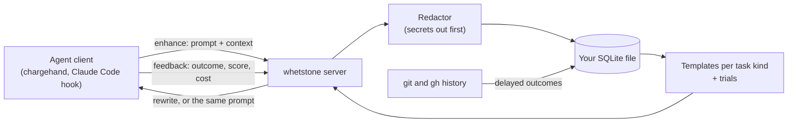

<!-- readme:header:start -->
<p>
  
  <a href="https://github.com/Egoushka/whetstone/actions/workflows/ci.yml"></a>
  
</p>
<!-- readme:header:end -->

# whetstone

> A personal prompt enhancer for people who use coding agents daily: it learns from your own runs which prompts work.

<!-- readme:status:start -->
**Research**. No code yet: a question and the notes toward an answer.
<!-- readme:status:end -->

A .NET 10 server that speaks [MCP](https://modelcontextprotocol.io) (Model Context Protocol, the standard
way agents call tools), so any agent client can use it; the first one is
[chargehand](https://github.com/Egoushka/chargehand), my agent orchestrator.



## Why

I write the same kinds of prompt every day: fix this test, review this diff, plan this feature. Each time I rewrite
it from memory and lose the part that made last week's version work. Agent clients keep a history but do not learn
from it, and each keeps it locked inside itself. I want one place that owns my prompts and gets better at them from
outcomes, not opinions: a template earns its place by the runs that used it being accepted, scoring well and costing
little ([VISION.md](VISION.md)).

## What it does

- Answers `enhance` with a rewrite or your prompt unchanged, inside the client's deadline. Any failure, delay or
  empty store returns the original prompt, so whetstone never stops a run.
- Remembers every call with secrets redacted first, in one SQLite file per user; `feedback` adds what happened.
- Runs trials: versioned templates per task kind, a held-out share that gets no template, and a challenger
  promoted only by a fixed rule (off by default, `WHETSTONE_TEMPLATES=on`).
- Scores runs from evidence that arrives later: commits, merged pull requests, first CI run, reverts.
- Imports past sessions from Claude Code and OpenCode, and replays them in a gym to screen a challenger before it
  reaches live traffic.
- Lets you take everything out or delete it from a terminal, never over MCP ([docs/privacy.md](docs/privacy.md)).

Not here: it does not run agents, pick a model, share prompts between users, or change a prompt without showing the
change. There is no hosted version and no encryption of its own.

## Quick start

You need the .NET SDK pinned in [global.json](global.json) (10.0.100 or a later feature band).

```bash
git clone https://github.com/Egoushka/whetstone && cd whetstone
scripts/check.sh                                                    # format, build with warnings as errors, tests (what CI runs)
WHETSTONE_API_KEY=local-test dotnet run --project src/Whetstone.Server -- serve &
curl http://127.0.0.1:7340/health                                   # {"status":"ok",...}
```

MCP is at `http://127.0.0.1:7340/v1/mcp` with `Authorization: Bearer <WHETSTONE_API_KEY>`; for a client that starts
the server itself, use `dotnet run --project src/Whetstone.Server -- mcp` (stdio). Every command, variable and field
is in the [reference](docs/guide/reference.md); the [quickstart](docs/guide/quickstart.md) walks one call from
`enhance` to `export`. A merge to `main` also publishes a container image to `ghcr.io/egoushka/whetstone`
([image.yml](.github/workflows/image.yml)).

## How it works

Three MCP tools: `enhance` (a prompt in, a prompt out), `brief` (the same for a brief a client is about to give a
subagent) and `feedback` (the outcome of a request). Their shapes are JSON schemas under [schemas/](schemas/),
versioned by major.

An `enhance` call is validated, then the enhancer gets 80% of the deadline and storage 15%, leaving 5% for the way
back. If the enhancer is late or throws, the answer is the original prompt with the reason. Storage runs after the
answer exists, so a broken disk changes no answer; it only counts a failure in `/health`
([architecture](docs/guide/architecture.md)).

The enhancer is a chain. The base passes the prompt through. Retrieval, if on, appends your closest earlier prompt
that scored well. Templates, if on, give each request of a known task kind the champion, a challenger or the
held-out answer, chosen by a hash of the kind and request id, and fill context slots such as a memory service. The
invariant behind all of it: whetstone is optional, and the original prompt always goes out when anything fails.

## Numbers

- Version 0.2.0 ([Directory.Build.props](Directory.Build.props)); goals 0.1 and 0.2 are met, 0.4 to 0.12 are built
  and tested and wait on live use to meet their bars ([ROADMAP.md](ROADMAP.md), [status](docs/guide/status.md)).
- The 0.2 bar: a week of my own use (2026-10-04 to 2026-10-11), then a secret scan over the full export, found
  nothing on 2026-10-12 ([status](docs/guide/status.md)).
- No trial has reached a decision yet, so there is no evidence today that a rewrite helps. How that will be measured,
  against the held-out share: [docs/evaluation.md](docs/evaluation.md).

## Read next

- [docs/guide/index.md](docs/guide/index.md): overview, then quickstart, architecture, reference, privacy, status.
- [VISION.md](VISION.md): the problem and what whetstone will not do.
- [ROADMAP.md](ROADMAP.md): goals in order, each written as what is true when it is done.
- [docs/evaluation.md](docs/evaluation.md): the bar each goal must meet.
- [docs/privacy.md](docs/privacy.md): what is stored, what leaves the machine, how to delete it.
- [docs/adr/](docs/adr/): decisions, from the MCP seam to the replay gym.
- [docs/specs/](docs/specs/) and [docs/plans/](docs/plans/): designs and plans per goal.
- [clients/claude-code/](clients/claude-code/): hooks that make Claude Code a client.
- [CHANGELOG.md](CHANGELOG.md), [SECURITY.md](SECURITY.md) and the [Apache-2.0 licence](LICENSE).
